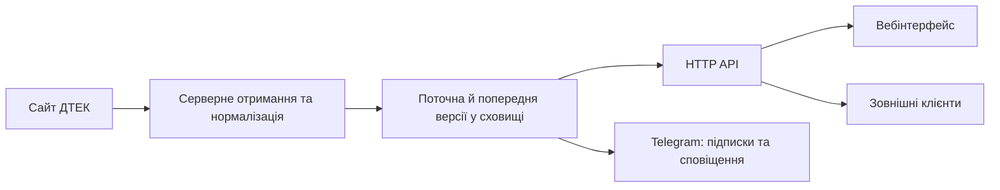

# Будова застосунку

## Потік даних

Розклад перевірок належить серверу. Звернення браузера або зовнішнього клієнта до API не запускає додатковий запит до ДТЕК. Один цикл отримання завершується до початку наступного: повільна відповідь джерела не створює паралельну чергу парсерів.

Необов'язковий VPN-проксі додає другий маршрут отримання джерела. Здорові маршрути чергуються; недоступний VPN тимчасово виключається до повторної перевірки здоров'я. Клієнтський API завжди читає спільний кеш незалежно від того, яким маршрутом його отримано.

## Представлення графіка

Одна дата містить до 12 груп: `1.1`, `1.2`, …, `6.2`. Для кожної групи сервер повертає 48 елементів, по одному на кожні пів години від `00:00` до `24:00`.

| Значення | Значення для клієнта |
| --- | --- |
| `true` | За добовим графіком світло є. |
| `false` | За добовим графіком світла немає. |
| `null` | Дані цього інтервалу невідомі або не розпізнані. |

Елемент `0` відповідає `00:00–00:30`, `1` — `00:30–01:00`, `47` — `23:30–24:00`. Дата належить часовій зоні `Europe/Kyiv`. Це календарний добовий графік із 48 позицій, а не часовий ряд UTC із вимірами фактичного електропостачання.

Це внутрішня форма даних і формат API `format=slots`. Типовий зовнішній API `format=compact` перетворює `false` на об'єднані інтервали `off`, `null` — на `unknown`, а однакові добові профілі об'єднує за групами. Відновлення станів не втрачає невідомих інтервалів. Докладний контракт: [API](api.md).

## Об'єднання відповідей

1. Витягти всі опубліковані дати з відповіді джерела.
2. Нормалізувати стани ДТЕК у півгодинні значення.
3. Для активного набору залишити сьогодні й завтра за київським часом.
4. Якщо одна з цих дат зникла з нової відповіді, зберегти раніше відомий день і позначити його як кешований.
5. При помилці залишити останню успішну версію та додати ознаку помилки/застарілості.

Сервер не домальовує відсутні дні з тижневого прогнозу. Повністю невідома дата не замінює раніше розпізнаний графік.

## Порівняння версій

Поточна й попередня версії зіставляються за точною датою та номером групи. Завтрашній графік не порівнюється із сьогоднішнім. Пунктир позначає змінені півгодинні позиції, а кольоровий номер — групу, де є відмінність. Ця індикація показує різницю з попередньою збереженою версією, а не повну історію всіх змін за день.

## Файли

| Шлях | Відповідальність |
| --- | --- |
| `server.js` | HTTP-сервер, періодична перевірка, стан застосунку та інтеграції. |
| `api.js` | Версійована відповідь API, фільтри, ETag та метадані кешування. |
| `schedule.js` | Витягування `DisconSchedule.fact`, нормалізація дат і груп, об'єднання днів. |
| `transport.js` | Чергування прямого/VPN-маршрутів і тимчасове виключення несправного проксі. |
| `public/dates.js` | Спільні обчислення київських дат, поточного інтервалу та залишку відключень. |
| `public/app.js` | Відображення двох днів, фільтр групи та оновлення інтерфейсу. |
| `public/index.html`, `public/style.css` | Структура і стилі сторінки. |
| `emergency.js` | Витягування актуального оголошення ДТЕК про екстрені відключення. |
| `telegram.js` | Команди бота, збережені підписки та черга відправлення. |
| `schedule-image.js` | Побудова картинки графіка для Telegram. |
| `vendor/constants.js`, `vendor/NOTICE.md` | Константи ДТЕК і зазначення автора вихідного проєкту. |
| `scripts/verify-ui.mjs` | Перевірка сторінки у Chromium. |
| `deploy/` | Додаткові конфігурації розгортання. |
| `deploy/vpn/supervisor.py` | PPTP-тунель, прив'язаний до нього HTTP-проксі та перевірка виходу в Інтернет. |
| `deploy/vpn/setup-host.py` | Завантаження PPP-модулів хоста та обмежене правило PPTP NAT helper для вибраної Docker-мережі й VPN-сервера. |

## Постійний стан

Стан зберігається у `DATA_DIR`, який у Docker підключено до постійного тому або bind mount. Резервна копія лише вихідного коду не зберігає отримані графіки й підписки Telegram. Для перенесення установки потрібні і код, і каталог даних, і локальна конфігурація `.env`.

Вибір групи у вебінтерфейсі зберігається в браузерному `localStorage`. Його немає у серверній базі підписок Telegram, і очищення сховища браузера скидає цей вибір.
